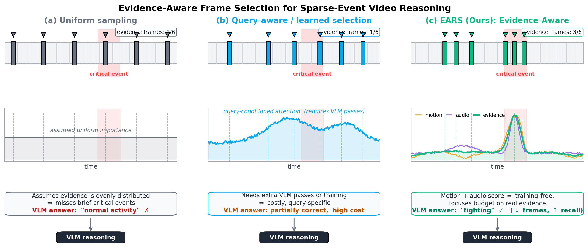

# EARS: Evidence-Aware Frame Routing

Official implementation of **EARS**, a training-free frame router for sparse-event video reasoning. EARS ranks frames with inexpensive motion and audio evidence, applies temporal Information Compression (IC), and sends only a small frame budget to a downstream vision-language model (VLM).



## Highlights

- Query-independent, training-free frame selection.
- Modality-intrinsic motion and audio evidence.
- Temporal NMS/Information Compression for diverse selections.
- Frozen global configuration: `alpha=1`, `beta=1`, `tau=0.5s`.
- Evaluators for XD-Violence and UCF-Crime with Qwen2-VL.
- Paper ablations, held-out tuning, semantic baselines, runtime benchmarks, compact results, and publication figures.

## Method

EARS computes aligned audio energy $E_t$ and motion magnitude $M_t$, normalizes the signals, and fuses them into an evidence score:

```text
A_t = sigmoid(alpha * E_t + beta * M_t)
```

IC greedily takes the highest remaining score and suppresses candidates within `tau` seconds. The selected `K` frames are decoded and passed to one VLM call.

## Key Results

F1 with `Qwen/Qwen2-VL-7B-Instruct` and one frozen configuration:

| Dataset | Method | K=1 | K=2 | K=10 |
| --- | --- | ---: | ---: | ---: |
| XD-Violence | Uniform | 0.310 | 0.534 | **0.961** |
| XD-Violence | EARS | **0.723** | **0.852** | 0.947 |
| UCF-Crime | Uniform | **0.159** | **0.324** | **0.497** |
| UCF-Crime | EARS | 0.128 | 0.273 | 0.473 |

EARS is strongest when the target event is brief and motion/audio evidence is informative. UCF-Crime is an important negative result: many videos lack useful audio and uniform coverage remains stronger. See [docs/RESULTS.md](docs/RESULTS.md) for artifact provenance and additional checks.

## Repository Layout

```text
EARS/
├── audio_features.py, motion_features.py    # modality evidence
├── event_attention.py, ic_selection.py      # fusion and temporal IC
├── frame_retrieval.py, video_loader.py      # frame selection and I/O
├── vlm_reasoning.py                         # VLM inference
├── evaluate_xdviolence.py                   # headline XD evaluation
├── evaluate_ucfcrime.py                     # headline UCF evaluation
├── run_ablations.py, tune_heldout.py         # paper experiments
├── run_aks_7b.py, semantic_features.py       # semantic selector baselines
├── bench_*.py                               # efficiency/robustness checks
├── make_paper_figures.py, make_figure1.py   # figure generation
├── configs/frozen_config.json               # frozen paper configuration
├── results/                                 # compact reported artifacts
└── assets/figures/                          # paper figures (PNG/PDF)
```

## Environment Setup

Tested on Linux with Python 3.10 and CUDA. CPU-only signal extraction works, but headline VLM evaluation requires a CUDA-capable PyTorch installation.

1. Install FFmpeg and create an environment:

   ```bash
   sudo apt-get install ffmpeg
   git clone https://github.com/mikeslin-ir/EARS.git
   cd EARS
   python3.10 -m venv .venv
   source .venv/bin/activate
   python -m pip install --upgrade pip
   ```

2. Install PyTorch for your CUDA version from [pytorch.org](https://pytorch.org/get-started/locally/), then install EARS:

   ```bash
   pip install -r requirements.txt
   ```

3. Configure dataset roots with environment variables or pass `--root`:

   ```bash
   export XD_VIOLENCE_ROOT=/path/to/XD_violence
   export UCF_CRIME_ROOT=/path/to/UCF-Crime
   ```

The first VLM run downloads the selected Hugging Face checkpoint. Configure Hugging Face authentication outside this repository if the checkpoint requires it.

## Dataset Layout

```text
$XD_VIOLENCE_ROOT/
└── test/
    ├── Fighting/
    ├── Shooting/
    └── Normal/

$UCF_CRIME_ROOT/
├── Anomaly-Videos-Part-*/
├── Testing_Normal_Videos/
└── ...
```

Dataset licenses do not permit redistribution here. Obtain each dataset from its official source and adapt [datasets.py](datasets.py) if your layout differs.

## Runbook

Run all commands from the repository root.

### 1. Smoke Check (No Dataset or GPU)

```bash
python - <<'PY'
import numpy as np
from config import EventAgentConfig
from ic_selection import select_topk_ic

cfg = EventAgentConfig()
assert (cfg.alpha, cfg.beta, cfg.tau_sec) == (1.0, 1.0, 0.5)
assert select_topk_ic(np.array([0.1, 0.9, 0.2, 0.8]), 2, tau_frames=1).tolist() == [1, 3]
print("EARS smoke check passed")
PY
```

### 2. Small XD-Violence Evaluation

```bash
python evaluate_xdviolence.py \
  --root "$XD_VIOLENCE_ROOT" \
  --max-videos 8 \
  --frame-budget 2 \
  --method event_driven \
  --event-config configs/frozen_config.json \
  --signal-cache-dir .cache/signals/xd \
  --results-dir results/local/xd_smoke
```

### 3. Frozen Headline Sweeps

Omit `--frame-budget` to evaluate every paper budget.

```bash
python evaluate_xdviolence.py \
  --root "$XD_VIOLENCE_ROOT" \
  --method both \
  --model-id Qwen/Qwen2-VL-7B-Instruct \
  --event-config configs/frozen_config.json \
  --signal-cache-dir .cache/signals/xd \
  --results-dir results/local/xd_full

python evaluate_ucfcrime.py \
  --root "$UCF_CRIME_ROOT" \
  --method both \
  --model-id Qwen/Qwen2-VL-7B-Instruct \
  --event-config configs/frozen_config.json \
  --signal-cache-dir .cache/signals/ucf \
  --results-dir results/local/ucf_full
```

Use `--method uniform` for an isolated Uniform control and `--method event_driven` for frozen EARS.

### 4. Component Ablations

```bash
python run_ablations.py \
  --dataset xdviolence --ablation modality --frame-budget 2 \
  --model-id Qwen/Qwen2-VL-7B-Instruct

python run_ablations.py \
  --dataset xdviolence --ablation ic_gap --frame-budget 4 \
  --gaps 0,0.5,1,2,4 \
  --model-id Qwen/Qwen2-VL-7B-Instruct
```

Use `python run_ablations.py --help` for adaptive-budget options.

### 5. Held-Out Configuration Search

```bash
python tune_heldout.py \
  --dataset both --n-per-class 60 \
  --model-id Qwen/Qwen2-VL-7B-Instruct
```

This writes tuning artifacts under `results/heldout/`. The paper's frozen output is bundled as [configs/frozen_config.json](configs/frozen_config.json).

### 6. Query-Aware / Learned Selector Baselines

```bash
python run_aks_7b.py \
  --dataset both --selector aks --k 1 2 4 6 8 10 \
  --model-id Qwen/Qwen2-VL-7B-Instruct

python run_aks_7b.py \
  --dataset both --selector topk --k 1 2 4 6 8 10 \
  --model-id Qwen/Qwen2-VL-7B-Instruct
```

The semantic baseline downloads `google/siglip-base-patch16-224` by default.

### 7. Runtime and Proxy Benchmarks

CPU-only signal timing:

```bash
python bench_runtime.py \
  --dataset both --max-videos 20 --k 4 --no-vlm \
  --xd-root "$XD_VIOLENCE_ROOT" --ucf-root "$UCF_CRIME_ROOT" \
  --output results/local/runtime_cpu.json
```

End-to-end timing removes `--no-vlm`. Additional checks:

```bash
python bench_motion_proxies.py --n-per-dataset 12
python bench_flow_scale_selection.py --dataset xd --n 120
python bench_selector_cost.py --n-per-dataset 12 --device cuda
```

### 8. Regenerate Figures

```bash
python make_paper_figures.py
python make_figure1.py
```

`make_paper_figures.py` regenerates figures supported by the compact public artifacts and leaves published figures untouched when optional raw predictions are absent. `make_figure1.py` also exports an editable PowerPoint file.

## Reproducibility Notes

- Headline evaluations use one frozen global setting from [configs/frozen_config.json](configs/frozen_config.json).
- Audio and motion signals can be cached and reused across all `K` values.
- Published JSON files contain aggregate metrics; datasets, model weights, signal caches, and full per-video predictions are intentionally excluded.
- Exact results depend on the model revision, PyTorch/CUDA stack, video decoder, and dataset copy. Record these details for new runs.

## Limitations

EARS assumes important events produce useful motion or audio evidence. It can underperform uniform coverage on dense narratives, weak-cue anomalies, title-card motion, camera motion, or videos without informative audio. It is a frame router, not a replacement for semantic reasoning or temporal video modeling.

## License

Released under the [Apache License 2.0](LICENSE).
